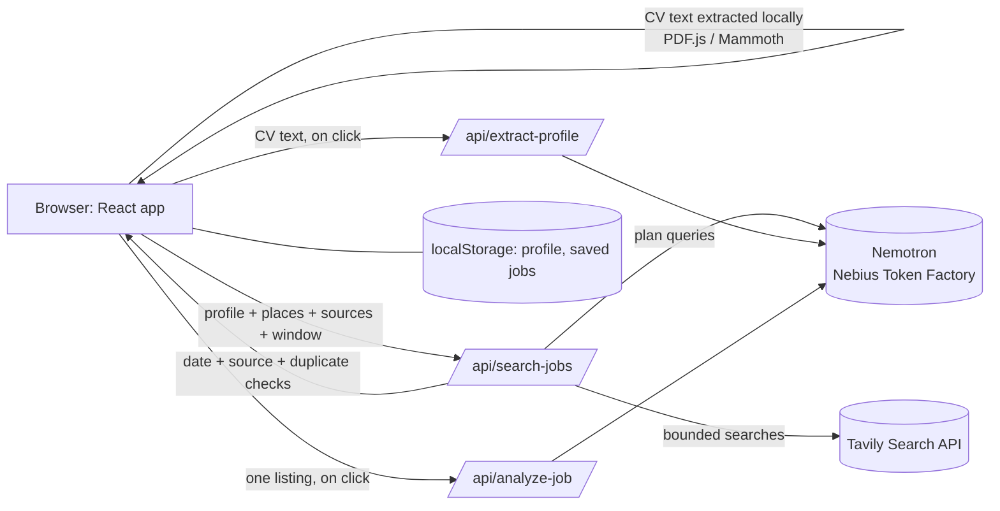

# CareerPilot Job Radar

**Find recent, relevant jobs from your own CV, see why each one may fit, and track your applications. Powered by NVIDIA Nemotron on Nebius Token Factory.**

Built for the **Nebius x NVIDIA Global AI Hackathon**, track **Best Apps and Agents**.

| | |
|---|---|
| **Live demo** | `https://YOUR-APP.vercel.app` |
| **Code** | https://github.com/creatoropener/CareerPilot |
| **License** | MIT (see [`LICENSE`](LICENSE)) |

> Judges: the live demo has the Nemotron and search keys already configured, so you do not need your own keys to try it. To run your own copy, follow [Run it yourself](#run-it-yourself).

---

## What it does

1. **Build a profile from your CV.** Upload a PDF, DOCX or TXT CV (up to 5 MB). Text is extracted **in your browser**; the file is never uploaded. Click *Extract profile with Nemotron* to get target roles, skills, education and location that you can edit.
2. **Choose where and on which sites to search.**
   - **Locations:** pick up to 5 places from a searchable worldwide list (about 23,600 cities plus every country). Accents and common alternative names work (Bangalore finds Bengaluru), "City, Country" works, and you can type any custom place.
   - **Sources:** pick from 97 job sites in a grouped, searchable list: global boards, India, US and Canada, UK and Ireland, Europe, Middle East and Africa, Asia-Pacific, Latin America, remote and startup boards, and employer career pages (Greenhouse, Lever, Workday, Ashby and more). Only the sites you tick are searched; results from any other site are dropped.
3. **Pick a mandatory time window:** last 1 day, 1 week, 2, 3 or 4 weeks. There is no "all time" option, and the server rejects a search without a valid window.
4. **Search.** Nemotron plans the search queries; Tavily fetches public results. A listing is shown only if a posting date inside your window can be verified. Listings with no verifiable date are hidden and counted, so the app favours freshness over volume.
5. **Review ranked results.** Each result is de-duplicated, links to the original listing, and shows a keyword match score with the matching terms and the skills not found in the listing.
6. **Ask Nemotron why.** *Explain with Nemotron* gives strengths, possible gaps and things to verify before applying. It never changes the score.
7. **Track applications.** Save jobs and move them through Saved, Applied, Interview, Offer and Rejected. Add a job by URL, and export or restore a JSON backup.

---

## How we use NVIDIA Nemotron and Nebius

**Model:** `nvidia/nemotron-3-super-120b-a12b` (NVIDIA Nemotron 3 Super), called through **Nebius Token Factory**'s OpenAI-compatible chat-completions API (`https://api.tokenfactory.nebius.com/v1`). The model is a setting (`NEBIUS_MODEL`), so another Nemotron model can be used without code changes.

Nemotron does three separate jobs, not just a chat box:

| # | Feature | Code | What Nemotron does | If the model is unavailable |
|---|---|---|---|---|
| 1 | **Resume to profile** | [`api/extract-profile.ts`](api/extract-profile.ts) | Reads CV text and returns target roles, skills, education, location and a one-line summary as JSON. Treats the CV as untrusted data. | Local rule-based extractor |
| 2 | **Search planning** | [`api/search-jobs.ts`](api/search-jobs.ts) | Turns the profile into three complementary queries (main title, adjacent titles, employer career pages), with a `{location}` token filled in per selected place. | Rule-based queries; the UI shows which queries ran and who planned them |
| 3 | **Job explanation** | [`api/analyze-job.ts`](api/analyze-job.ts) | Explains strengths, gaps and what to verify for one listing. | A "not configured" message; nothing else breaks |

**Design rule:** the match score, date checks, de-duplication and source filtering are deterministic TypeScript. Nemotron only extracts, plans and explains, so a model mistake cannot change a ranking or let an out-of-window listing through.

**Where Token Factory helped:**
- **Simple integration.** The OpenAI-compatible endpoint meant plain `fetch` calls from three Vercel functions, with one API key and no SDK or GPU to manage.
- **Easy model choice.** Changing the model is one environment variable.
- **Server-side key.** The key lives in Vercel environment variables and never reaches the browser.

**Other Nebius services:** Nebius Token Factory is the only Nebius service CareerPilot calls at run time. (Our separate project, Shadow Patch, uses Nebius Sandboxes; it is not part of this app.)

---

## Architecture



Privacy by design: the profile and saved jobs stay in `localStorage`. The search request carries only target roles, skills, locations and work mode. CV text reaches the model only when you click an AI button, and your resume is included in job explanations only if you tick the opt-in box.

Cost control: at most **8 Tavily calls per search click**. Selected sites are grouped (about four per call) and each group is searched per selected place; with many places and sites the groups are merged, so everything selected is still covered with fewer result slots per site. The AI endpoints have a best-effort per-IP rate limit.

---

## Run it yourself

**Requirements:** Node.js 20.19 or newer, npm. Optional keys: a [Nebius Token Factory](https://tokenfactory.nebius.com) API key (Nemotron features) and a [Tavily](https://tavily.com) API key (job search results).

### 1. Install and start the UI

```bash
git clone https://github.com/creatoropener/CareerPilot.git
cd CareerPilot
npm install
npm run dev
```

This runs the interface only. CV upload, local profile extraction, manual job entry, the tracker and the direct-search links all work without any keys. The AI and search endpoints need step 2.

### 2. Run with the serverless functions and your keys

Create a git-ignored `.env.local` file in the project root:

```bash
TAVILY_API_KEY=your_tavily_key
NEBIUS_API_KEY=your_nebius_token_factory_key
# optional
NEBIUS_MODEL=nvidia/nemotron-3-super-120b-a12b
NEBIUS_BASE_URL=https://api.tokenfactory.nebius.com/v1
```

Then start the app with the Vercel CLI (the first run asks you to log in and link a project):

```bash
npx vercel dev
```

Open the address it prints. **Never put keys in frontend code, `VITE_*` variables or a committed file.**

| Variable | Needed for | Default |
|---|---|---|
| `NEBIUS_API_KEY` | Nemotron: profile extraction, query planning, explanations | none (features fall back or show "not configured") |
| `TAVILY_API_KEY` | Live job search results | none (app shows direct-search links) |
| `NEBIUS_MODEL` | Choose the Nemotron model | `nvidia/nemotron-3-super-120b-a12b` |
| `NEBIUS_BASE_URL` | Token Factory endpoint | `https://api.tokenfactory.nebius.com/v1` |

### 3. Deploy to Vercel

1. Push the repository to GitHub and import it in Vercel (**Add New, then Project**). The Vite preset is detected, and [`vercel.json`](vercel.json) sets the build command, output folder and a 60-second limit for each function.
2. Under **Settings, then Environment Variables**, add `TAVILY_API_KEY` and `NEBIUS_API_KEY` (Production and Preview).
3. Deploy, or redeploy after adding the variables.

### 4. Try it in two minutes

1. Open the app and upload a CV (or paste your experience).
2. Click **Extract profile with Nemotron** and review the result.
3. Choose one or more places, tick a few sources, and pick a time window.
4. Click search. Check the ranked results, the queries used, and the "hidden" count.
5. Click **Explain with Nemotron** on a result, then save it and change its stage.

### Tests and build

```bash
npm test          # fast node:test suite (the one used by CI and Shadow Patch)
npm run test:all  # also runs the vitest suite (55 tests)
npm run build     # type-check and production build
```

Provider calls are mocked in the tests, so no keys are needed.

---

## Limitations

- Matching is a transparent **keyword-overlap estimate** from a result's title, URL and snippet. It is not an AI assessment, a hiring probability, or proof that a role is open. Always open the original listing.
- Jobs are found through public web search (Tavily), not by logging in to or scraping portals. Coverage is partial, and results can include expired listings or category pages.
- The freshness filter is best-effort. Two edge cases are known: a search provider's date can disagree with an older "Posted N days ago" text on the page, and some listing-age formats (such as "a month ago" or "30d+") are not recognised yet.
- Scanned (image-only) CVs are not supported; paste the text instead.
- No accounts or cloud sync: data stays in this browser. Export a backup before clearing browser storage.
- Before wide public use it needs persistent rate limiting, caching and a privacy notice. Automatic form filling and automated applying are deliberately not included.

---

## Project structure

```text
api/
  search-jobs.ts        Vercel Function: Nemotron query planning + Tavily search + date/source filtering
  analyze-job.ts        Vercel Function: Nemotron job explanation
  extract-profile.ts    Vercel Function: Nemotron CV to profile
lib/
  sources.ts            Catalogue of 97 job sites and their domains (shared by browser and server)
  recency.ts            Posting-date detection, time windows, domain matching
src/
  App.tsx               UI, profile, results and application tracker
  components/           LocationPicker and SourcePicker multi-selects
  lib/                  Matcher, CV text extraction, locations, time windows, types
  data/places.json      Generated place data (GeoNames)
scripts/build-places.mjs  Regenerates places.json
tests/                  node:test (*.test.ts) and vitest (*.spec.ts) suites
vercel.json             Build and function configuration
```

## Built with

React 19 · TypeScript · Vite · Vercel (hosting and serverless functions) · **NVIDIA Nemotron** (`nvidia/nemotron-3-super-120b-a12b`) · **Nebius Token Factory** · Tavily Search API · PDF.js · Mammoth.js · GeoNames place data · Vitest · Claude (coding assistant)

## Data attribution

Place names come from [GeoNames](https://www.geonames.org), licensed under [Creative Commons Attribution 4.0](https://creativecommons.org/licenses/by/4.0/), through the `all-the-cities` and `country-list` npm packages (MIT). To regenerate `src/data/places.json`, run `npm install --no-save all-the-cities country-list` and then `node scripts/build-places.mjs`.

## License

MIT. See [`LICENSE`](LICENSE).
